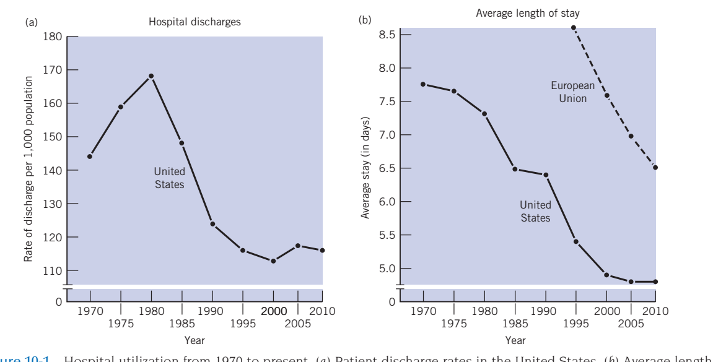
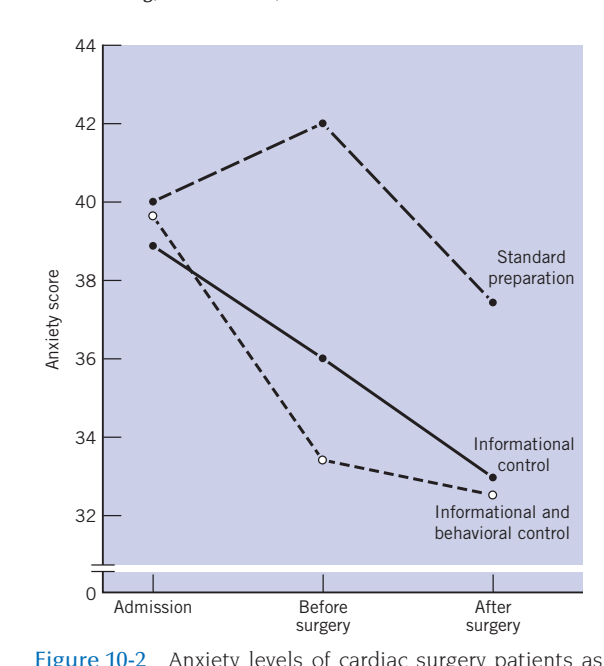
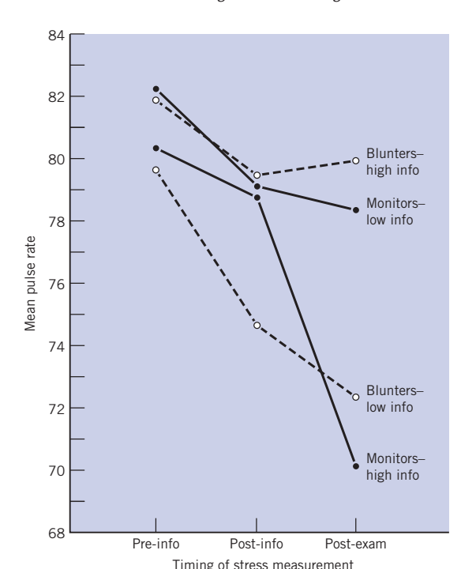
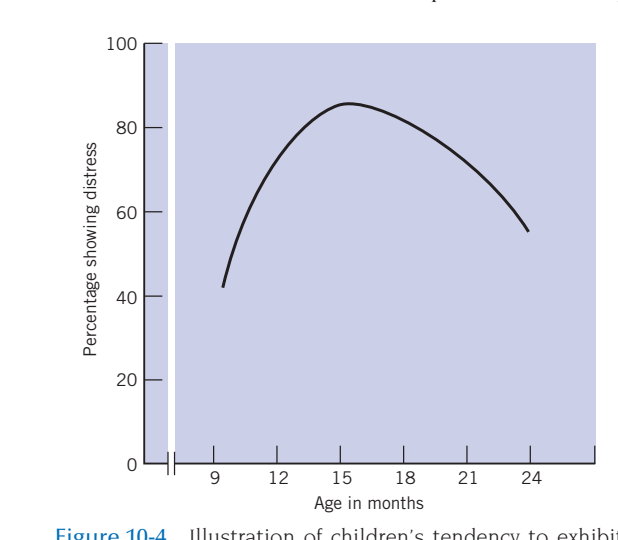
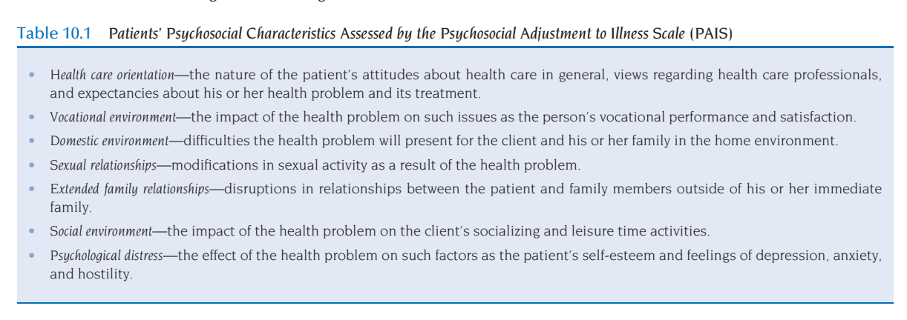
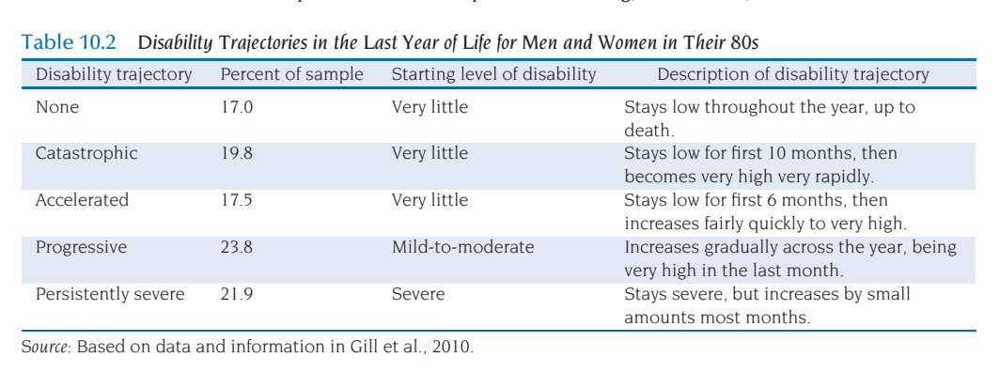
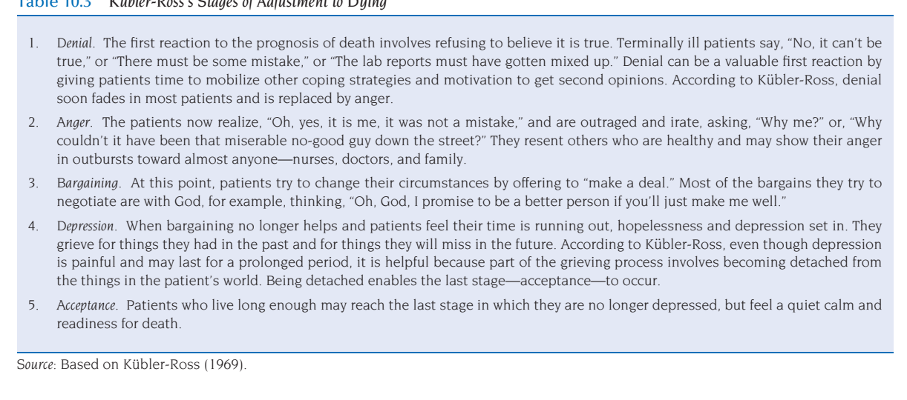

# 第十章 醫院：環境、醫療處置與對病患的心理影響

返回 [單篇文獻索引](./_index.md) ｜ [知識庫總目錄](../index.md)

# 第十章 醫院：環境、醫療處置與對病患的心理影響

## 1. 導論與醫院之歷史演進

現代醫院作為高度專業化的醫療機構，其歷史形象經歷了顯著變遷。早期古希臘之神殿療癒與羅馬軍營軍醫院為其雛形；中世紀基督教會設立之醫院（如西元 542 年法國里昂之 Hôtel-Dieu）則帶有強烈慈善性質，收容對象涵蓋貧民、孤兒與旅客（Anderson & Gevitz, 1983）。直至 19 世紀，醫院仍因感染控制不良與高死亡率而惡名昭彰，富裕階層多選擇在家接受醫療。20 世紀後，隨著醫學知識、麻醉與無菌技術之突破，醫院轉型為現代化治療與康復中心。至今，美國每年住院人次超過 3,400 萬，歐盟則達 8,200 萬人次（NCHS, 2015; WHO/Europe, 2015）。

## 2. 醫院組織結構、醫療風險與成本控制

醫院組織採取行政體系與醫療團隊之雙軌並行體系（Dual Lines of Authority）。醫療團隊包含醫療總監（Medical Director）、主治醫師（Attending Physicians）、住院醫師（Residents）、護理人員及各類醫事技術人員（Allied Health Workers）。

### 院內感染與系統安全
現代醫院照護高度分工，易導致照護碎片化（Fragmented Care）。此外，院內感染（Nosocomial Infection）亦為重大安全威脅。美國每年約有 5% 的住院患者（約 170 萬人）罹患院內感染，造成數萬人死亡（CU, 2010），其中抗藥性金黃色葡萄球菌（MRSA）尤為棘手。研究顯示，透過行為檢核表與感控護理師（Infection Control Nurse, ICN）之監督能提升遵從率，但需定期補充教育以維持效果（DeVries et al., 1991; Vincent, 2003）。

### 成本控制與住院天數
受到預先支付制度（Prospective-Payment System, PPS）與診斷關聯群（Diagnostic-Related Groups, DRGs）之推行，醫院有強烈動機縮短平均住院天數（Length of Stay）。自 1980 年代起，美歐國家之住院率與住院天數大幅下降（見下表與 Figure 10-1），促使門診手術與居家照護快速發展。

## 3. 醫患關係、去個人化與職業倦怠

住院經歷迫使患者進入高度依賴與喪失隱私的「病人角色」（Sick-Role）。

### 去個人化現象
醫護人員因面對高強度工作壓力與生死衝突，常不自覺使用 [醫療去個人化](../concepts/depersonalization-in-healthcare.md)（Depersonalization / Nonperson Treatment）作為防禦機制，將患者視為「物件」或「不在場之體」（Goffman, 1961; Zimbardo, 1970）。雖然去個人化能短期保護醫療人員之情緒，卻大幅提升病患之孤立感與不安。

### 醫療人員之職業倦怠
長期處於情緒高壓環境易引發 [醫療人員職業倦怠](../concepts/hospital-burnout.md)（Burnout）。Maslach 與 Jackson (1982) 指出倦怠包含三項核心構念：
1. **情緒耗竭（Emotional Exhaustion）**：個體感覺情緒資源枯竭。
2. **去個人化（Depersonalization）**：對服務對象產生冷漠與非人性化態度。
3. **個人成就感低落（Perceived Inadequacy of Professional Accomplishment）**：自我效能感下降。

研究顯示，醫師與護理師普遍呈現高度情緒耗竭；直接照護病患時間越長者，倦怠風險越高。高護理倦怠率亦與院內感染率呈顯著正相關（Cimiotti et al., 2012）。

## 4. 病人應對歷程與心理抗拒

Lorber (1975) 研究發現，醫護團隊常將配合度高、不抱怨之順從患者劃分為「好病人」（Good Patients），而將頻繁求助、情緒化或不合作者標籤為「問題病人」（Problem Patients）。

當病情輕微之患者因失去自主權而展現憤怒抗拒時，此現象稱為 [住院病人角色與心理抗拒](../concepts/sick-role-reactance.md)（Psychological Reactance; Brehm, 1966）。相反地，「好病人」過度壓抑需求可能源於習得無助感（Learned Helplessness; Raps et al., 1982），甚至與術後憂鬱及較高之死亡率有所關聯（Cavanaugh et al., 2001）。

## 5. 侵入性醫療程序之心理準備

針對手術或侵入性檢查（如心導管檢查 Cardiac Catheterization、胃鏡檢查 Endoscopy），實施 [醫療程序心理準備](../concepts/psychological-preparation-for-medical-procedures.md) 能顯著減輕壓力（Anderson & Masur, 1983）。

### 三種控制機制
- **行為控制（Behavioral Control）**：指導特定應對動作（如深呼吸、咳嗽技巧）。
- **認知控制（Cognitive Control）**：引導患者重構體驗，關注正向效益（Langer et al., 1975）。
- **資訊控制（Informational Control）**：提供程序與感覺訊息（Procedural & Sensory Information）。

### 臨床實驗證據與應對風格交互作用
Anderson (1987) 針對冠狀動脈繞道手術患者進行實驗，結果顯示接受資訊控制與行為控制訓練之患者，術後急性高血壓（Acute Hypertension）併發症發生率由對照組的 75% 顯著降低至 45% 與 40%（Figure 10-2）。
然而，Miller 與 Mangan (1983) 發現，心理準備之效益受到患者應對風格（Coping Style）之調節：
- **注意力型（Monitors）**：偏好詳細訊息，給予高資訊能顯著降低生理激發。
- **迴避型（Blunters）**：偏好避開威脅訊息，過多資訊反倒引發持續性高脈搏與焦慮（Figure 10-3）。

## 6. 兒童住院應激與分離焦慮

兒童住院體驗受其發展階段影響。幼兒期（1–4 歲）最核心的壓力源為 [兒童住院應激與分離焦慮](../concepts/child-hospitalization-distress.md)（Separation Distress），通常在 15 個月大時達到高峰（Figure 10-4; Bowlby, 1969; Super, 1981）。長期分離易引發抗議、絕望與情感疏離等階段反應。

學齡兒童則常伴隨「疾病為犯錯懲罰」之認知迷思（Ramsey, 1982）。採用模範影片（如《Ethan Has an Operation》; Melamed & Siegel, 1975）、偶戲示範與家長同房陪病（Room-in），能顯著降低兒童之焦慮與住院天數。

## 7. 健康心理學家之評估工具與角色

心理學家在醫院中承擔臨床評估、準備訓練、遵從性提升及復健介入等任務。常用標準化工具包括：
- **MMPI-2**：透過 [MMPI 神經質三合症](../methods/mmpi-neurotic-triad.md)（Hs, D, Hy）評估慢性身心適應障礙。
- **MBMD**：[密倫行為醫學診斷量表（MBMD）](../methods/millon-behavioral-medicine-diagnostic.md)，評估應對風格、負面健康習慣及醫療遵從性預測。
- **PAIS**：[疾病心理社會適應量表（PAIS）](../methods/psychosocial-adjustment-to-illness-scale.md)，從健康照護定向、職業、家庭、性生活、擴展家庭、社交環境與心理痛苦七維度全面測量適應狀況。

## 8. 末期疾病、臨終應對與安寧療護

面對不可逆末期疾病，患者的心理適應呈現高度動態性。Kübler-Ross (1969) 提出臨終適應五階段（否認、憤怒、討價還價、憂鬱、接受），但後續研究指出多數患者之適應歷程並非線性順序，而是多種情緒交替存在（Kalish, 1985; Silver & Wortman, 1980）。

[末期疾病與安寧療護](../concepts/terminal-illness-and-palliative-care.md)（Hospice Care）由 Cicely Saunders 倡導，強調以緩和醫療（Palliative Care）為核心，控制疼痛與症狀，並提供患者與家屬跨領域之身體、心理、社會及靈性支持（Rabow & Pantilat, 2015）。研究證實安寧照護能大幅提升患者臨終品質並降低家屬悲傷適應障礙。

## 9. 關鍵統計與臨床研究數據彙整

| 研究主題 / 指標 | 統計數值 / 研究結果 | 數據來源 / 參考文獻 |
| :--- | :--- | :--- |
| 美國/歐盟每年急性住院人次 | 美國 > 3,400 萬人；歐盟 8,200 萬人 | NCHS (2015); WHO/Europe (2015) |
| 美國民眾臨終發生於醫院或養老院比例 | 75% – 80% | Rabow & Pantilat (2015) |
| 美國醫院院內感染率及年罹患人數 | 約 5% 的住院患者（約 170 萬人/年） | CU (2010) |
| 繞道手術心理準備對術後急性高血壓之影響 | 標準準備組：75% 發生；資訊控制組：45%；資訊+行為控制組：40% | Anderson (1987) |
| 同房室友狀態對心臟手術復原之影響 | 術後室友組比術前室友組顯著降低焦慮，提前 1.4 天出院 | Kulik & Mahler (1987a) |
| 兒童短期分離焦慮高峰年齡 | 15 個月大（跨文化一致，美/瓜地馬拉約 70–90%） | Super (1981); Figure 10-4 |
| 美國 60 歲以上臨終者具生前預立遺囑（Living Will）比例 | 約 66.7% (2/3) | Silveira et al. (2010) |
| 80 歲以上高齡者臨終前一年失能軌跡 | 無失能 (17.0%)、災難型 (19.8%)、加速型 (17.5%)、漸進型 (23.8%)、持續重度 (21.9%) | Gill et al. (2010); Table 10.2 |

## 自動擷取之關鍵圖表

### 美國與歐盟歷年住院出院率與平均住院天數變遷趨勢圖（第 265 頁，Figure 10-1）

### 心臟手術患者接受不同心理準備介入前後之 STAI 焦慮分數變化（第 271 頁，Figure 10-2）

### 應對風格（Monitors vs. Blunters）與訊息量對侵入性檢查壓力脈搏之影響（第 274 頁，Figure 10-3）

### 幼兒短期分離焦慮隨年齡變化的跨文化百分比分布圖（第 275 頁，Figure 10-4）

### 疾病心理社會適應量表（PAIS）評估之七大生活領域（第 280 頁，Table 10.1）

### 八十歲以上年長者臨終前一年的五種失能軌跡分類（第 281 頁，Table 10.2）

### 庫伯勒-羅斯（Kübler-Ross）臨終心理適應五階段模型（第 282 頁，Table 10.3）

