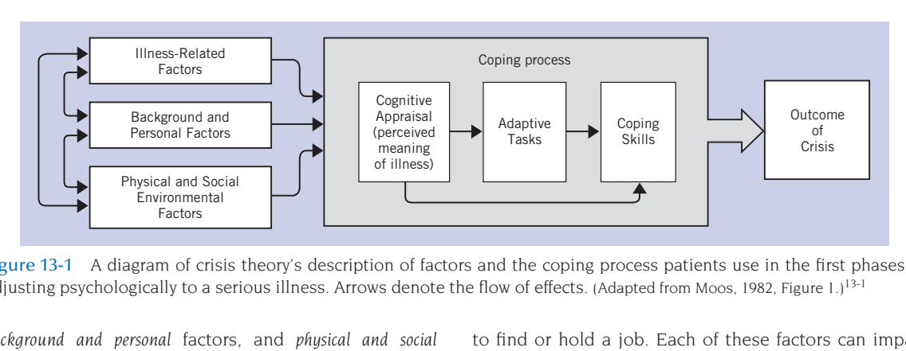
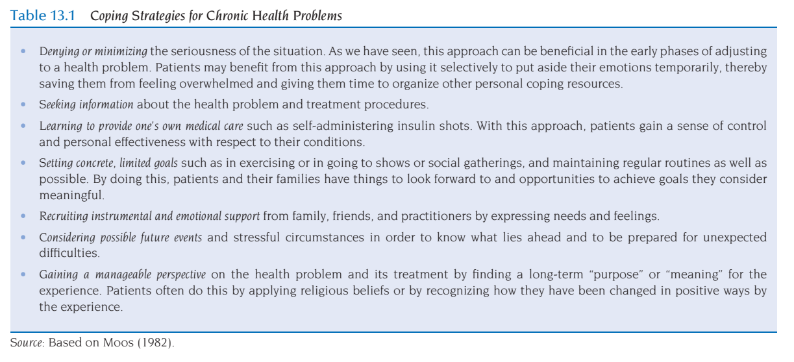
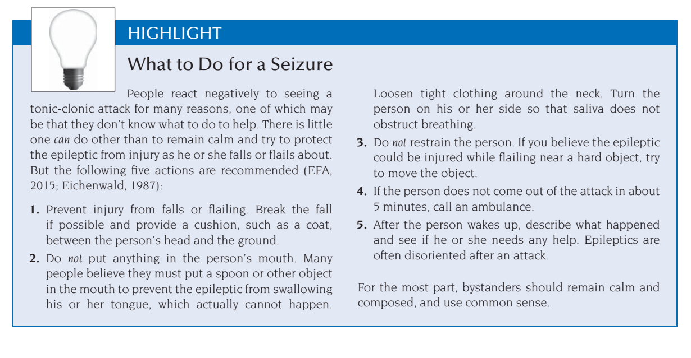
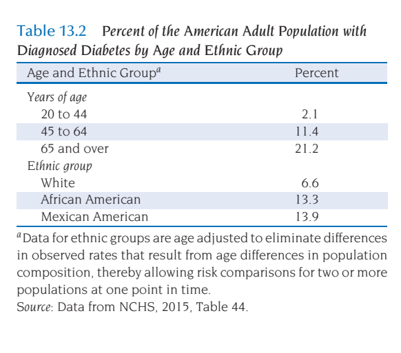
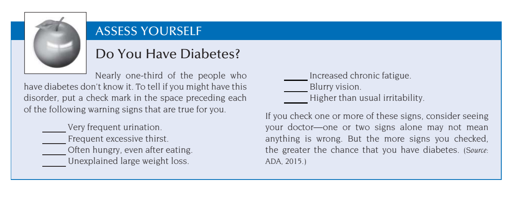
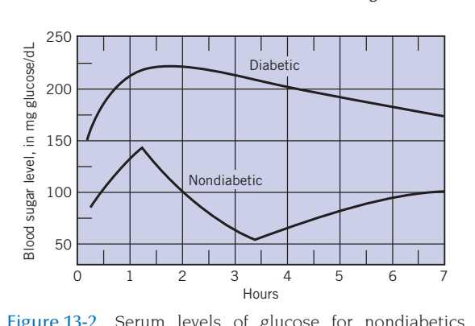
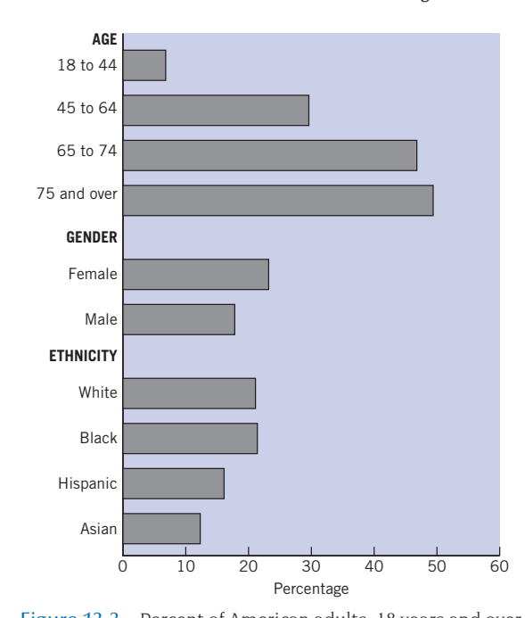
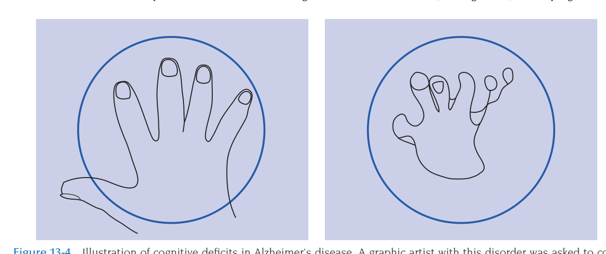

# Chapter 13: Serious and Disabling Chronic Illnesses: Causes, Management, and Coping

返回 [單篇文獻索引](./_index.md) ｜ [知識庫總目錄](../index.md)

# Chapter 13: Serious and Disabling Chronic Illnesses: Causes, Management, and Coping

返回 [單篇文獻索引](../papers/_index.md)

## 1. 慢性疾病的心理適應歷程（Adjusting to a Chronic Illness）

當個體被診斷出罹患嚴重或致殘性慢性疾病時，其心理歷程通常從初始的心理衝擊逐漸轉變為長期的自我管理與生活重組。

### 1.1 初始反應（Initial Reactions）
* **震驚（Shock）**：患者初次聽聞診斷時，常感到麻木、茫然或以機械化、解離（detached）的方式行動。若疾病突然發作，震驚反應最為顯著。
* **否認與迴避（Denial and Avoidance Strategies）**：在情緒未及消化前，患者常使用否認策略以控制情緒衝擊。然而過度迴避會阻礙患者吸收醫護人員提供的關鍵衛教資訊，導致不良的身體與心理預後。

### 1.2 危機理論（Crisis Theory）
Rudolf Moos 提出的 [危機理論](../concepts/crisis-theory-of-chronic-illness.md) 描述了個體適應健康危機的動態架構。危機的最終結果（即心理適應程度）取決於**應對歷程（Coping Process）**，而該歷程由三大影響因子決定：
1. **疾病相關因素（Illness-Related Factors）**：包括疾病的威脅性、致殘度、毀容程度、症狀是否令人尷尬（如失禁、異味）、治療方案的痛苦或副作用與生活型態限制。
2. **背景與個人因素（Background and Personal Factors）**：包括年齡、性別、社會階級、堅韌性格（Hardiness）、自我氣概（Self-Esteem）、發展階段（如兒童對活動限制的挫折、青少年對同儕排斥的恐懼、成年人對生涯中斷的怨恨）以及自我責備（Self-Blame）與災難化思考（Catastrophizing）。
3. **物理與社會環境因素（Physical and Social Environmental Factors）**：包括醫院環境的單調限制、居家環境的無障礙設施配置，以及家庭與社會支持網路（Social Support）的品質。

### 1.3 應對歷程、適應任務與技巧（The Coping Process, Adaptive Tasks, and Skills）
危機理論強調應對始於對疾病意義的**認知評估（Cognitive Appraisal）**，隨後形成兩大類**適應任務（Adaptive Tasks）**：
* **疾病或治療相關任務**：應對症狀與失能、適應醫療環境與治療方案、與醫事人員建立並維持良好關係。
* **一般心理社會功能任務**：控制負面情緒並維持積極展望、維持良好的自我形象與能力感、維持與家人朋友的良好關係、為不確定的未來做準備。

患者選擇性地運用多種應對技巧（如否認/極小化、尋求資訊、自我照護學習、設定具體目標、尋求支持、預想未來情境、賦予疾病長期意義）。

### 1.4 長期適應與生活品質（Long-Term Adaptation & Quality of Life）
長期適應（Adaptation）指個體建設性地調整生活狀況的歷程。慢性病管理將焦點從單純消除病灶拓寬至提升患者的**生活品質（Quality of Life, QoL）**。慢性病患者出現憂鬱與焦慮等嚴重心理痛苦的機率比一般人口高出 2 至 3 倍，若未善加處置，心理痛苦將進一步惡化病情發展。

---

## 2. 各類特定慢性疾病的衝擊與臨床特徵（Impacts of Different Chronic Conditions）

本章採用生命週期（Life-Span Perspective）視角，順序探討自童年期至老年期常見的慢性疾病：

### 2.1 哮喘（Asthma）
* **病理與發作誘因**：免疫系統呈過敏性反應，致使支氣管平滑肌痙攣、發炎並分泌過多黏液。發作誘因（Triggers）包括個人因素（呼吸道感染、憤怒或焦慮情緒）、環境因素（空氣污染、花粉、冷空氣）及物理活動（劇烈運動）。
* **心理社會因素**：人際衝突可誘發兒童哮喘症狀；焦慮會增強症狀知覺；對呼吸困難的災難化評估會顯著加劇發作強度。研究顯示，暗示（Suggestion）與古典制約能引發哮喘症狀。

### 2.2 癲癇（Epilepsy）
* **症狀與類型**：大腦皮質異常電衝動所致，最嚴重形式為強直陣攣發作（Tonic-Clonic / Grand Mal），包含意識喪失與肌肉痙攣。發作前可能出現光、聲或氣味等預兆（Aura）。
* **處置與心理衝擊**：主要以抗痙攣藥物（Anticonvulsant Drugs）控制（約 60% 有效），或進行迷走神經刺激與外科手術（手術成功率可達 70%）。癲癇患者面臨極大的社會污名化（Stigma）、認知或運動功能限制及就業歧視。

### 2.3 脊髓損傷（Spinal Cord Injury）
* **類型與生理影響**：脊髓神經受損導致運動、感覺與反射功能喪失。頸部脊髓受損導致**四肢癱瘓（Tetraplegia / Quadriplegia）**，胸腰椎受損導致**截癱（Paraplegia）**。
* **復健與心理適應**：復健包含腸道與膀胱控制訓練、殘餘肌肉強化、生物回饋及生活自理能力重建（Activities of Daily Living, ADL）。心理適應的關鍵在於克服憂鬱、重塑自我概念、處理配偶的角色轉換與性功能障礙（Psychosocial Barriers to Sexual Functioning）。

### 2.4 糖尿病（Diabetes Mellitus）
* **病理分類**：
  * **第 1 型糖尿病（Type 1 Diabetes）**：自體免疫破壞胰臟胰島細胞，無法分泌胰島素，多於兒童或青少年期發病，需每日注射胰島素，否則易誘發急性**酮酸中毒（Ketoacidosis）**。
  * **第 2 型糖尿病（Type 2 Diabetes）**：占絕大多數，多於 40 歲後發病，主要表現為胰島素抗性（Insulin Resistance），與肥胖、飲食及慢性壓力密切相關。
* **健康隱患與依從性**：高血糖（Hyperglycemia）會導致神經病變（Neuropathy）、視網膜病變、腎衰竭、心血管疾病及截肢風險。然而患者對飲食與運動方案的醫囑依從性通常低於 50%，且自我監測記錄常有不實情事。

### 2.5 關節炎（Arthritis / Rheumatic Diseases）
* **常見類型**：**骨關節炎（Osteoarthritis）**（關節磨損退化，最普遍）、**類風濕性關節炎（Rheumatoid Arthritis）**（自體免疫引發關節組織嚴重發炎與畸形，最致殘）、**痛風（Gout）**（尿酸結晶沉積）及**纖維肌痛症（Fibromyalgia）**。
* **心理社會歷程**：慢性疼痛與失能易引發無助感（Helplessness）與災難化思考，形成「疼痛-壓力-症狀加劇」的惡性循環。配偶間對疾病控制感的認知一致性（Congruence）有助於改善患者與照顧者的心理適應。

### 2.6 阿茲海默症（Alzheimer's Disease）
* **特徵與病理**：失智症（Dementia）中最常見的形式，腦部存在神經纖維纏結（Tangles）與澱粉樣蛋白斑塊（Plaques）。早期表現為近期記憶與注意力衰退，逐漸發展為全盤認知退化、人格改變與行為失常。
* **照顧者負擔（Caregiver Burden）**：家庭照顧者（多為配偶或成年子女）長期承受極高的生理與心理壓力，研究證實照顧者常出現免疫功能下降、壓力荷爾蒙升高及高憂鬱率，即 [失智症照顧者負擔](../concepts/dementia-caregiver-burden.md)。

---

## 3. 慢性病統計數據與臨床指標（Empirical & Statistical Summary）

以下整理自本章內文報告之各項關鍵統計數值與流行病學數據：

| 疾病類別 | 流行病學 / 統計指標 | 原文報告數據 | 備註與說明 |
| :--- | :--- | :--- | :--- |
| **美國慢性病總況** | 全美患慢性病成人數 | > 1.3 億人（近 1/2 成人） | 約 1/4 患者伴隨每日活動限制 |
| **哮喘 (Asthma)** | 全球患者數 / 美國患者數 | 全球 2.35 億人；美國近 2,600 萬人 (8%) | 美國每年約 3,600 人死於哮喘 |
| | 每年醫療與社會成本 (US) | 1,400 萬工作日損失、1,050 萬缺課日、200 萬急診、44 萬住院 | 原文未報告醫療費用總金額 |
| **癲癇 (Epilepsy)** | 全球患者數 / 美國患者數 | 全球 6,500 萬人；美國近 200 萬人 | 美國每年新增 15 萬例 diagnosis |
| | 藥物與手術控制率 | 抗痙攣藥物控制率約 60%；手術後可達 70% 無發作 | 迷走神經刺激器亦為替代方案 |
| **脊髓損傷 (SCI)** | 全美現存人數 / 每年新增 | 現存 > 27 萬人；每年新增約 12,500 例 | > 50% 為四肢癱瘓（Tetraplegia） |
| | 預期壽命估計 | 20 歲受傷截癱者可再存活約 45 年；四肢癱瘓者存活約 35–40 年 | 早期主因為反覆感染致腎衰竭 |
| **糖尿病 (Diabetes)** | 全球患者數 / 美國診斷數 | 全球 3.47 億人；美國診斷 > 2,100 萬人 | 美國另有約 800 萬未診斷患者 |
| | 死亡率與依從性 | 美國每年致死 > 7.5 萬人；全球致死 > 340 萬人 | < 50% 患者達到推薦血糖控制目標 |
| | 美國成人確診率（年齡） | 20-44 歲: 2.1%；45-64 歲: 11.4%；65 歲以上: 21.2% | （見 Table 13.2） |
| | 美國成人確診率（族群） | 白人: 6.6%；黑人: 13.3%；墨西哥裔裔: 13.9% | 已排除年齡結構差異之校正數據 |
| **關節炎 (Arthritis)** | 全美患病數 | 成人約 5,300 萬人；兒童約 30 萬人 | > 40% 患者表示有日常活動限制 |
| | 75 歲以上老年人盛行率 | 約 50% | 女性盛行率高於男性（痛風除外） |
| **阿茲海默症 (AD)** | 美國患者數 / 盛行率 | 美國約 5,300 萬人（65 歲以上 11%；85 歲以上近 33%） | 病程持續衰退約 5 至 10 年 |

---

## 4. 心理社會介入方法（Psychosocial Interventions）

為解決慢性病帶來的生理、職涯、自我概念、社交、情緒及處方遵從性等調整問題（Table 13.4），臨床上發展出多種介入模式：

1. **衛教、社會支持與行為方法**：
   * 提供疾病與醫療資源之正確資訊，消除不實恐慌與照護迷思。
   * 建立專業或同儕支持團體（Support Groups），減輕污名感與孤立感。
   * 使用行為契約（Behavioral Contracting）、自我監測（Self-Monitoring）與強化技術，提升復健與處方遵從性。
   * 推廣 [慢性病自我管理計畫](../concepts/self-management-in-chronic-illness.md)（Self-Management Programs），如 [關節炎自我管理計畫](../methods/arthritis-self-management-program.md)（ASMP）。
2. **放鬆與生物回饋（Relaxation and Biofeedback）**：
   * 漸進肌肉放鬆（PMR）與肌電圖/氣流生物回饋可用於減少哮喘發作、降低糖尿病患者的交感神經應激（減少腎上腺素與皮質醇對血糖的干擾），以及輔助癲癇腦電圖（EEG）自我調節。
3. **認知方法（Cognitive Methods）**：
   * **問題解決訓練（Problem-Solving Training）**：協助患者系統性擬定應對日常醫療障礙的策略（如在外用餐時的血糖控制方案）。
   * **認知重構（Cognitive Restructuring）**：識別並替換無助感、絕望與災難化等扭曲想法，降低憂鬱並增加自信與能力感。
4. **人際與家庭治療（Interpersonal and Family Therapy）**：
   * 重新調整家庭成員間的照護分工與互動模式，解決手足嫉妒、溝通障礙，並減少過度保護（Overprotectiveness）。
5. **協同與整合照護模式（Collaborative / Integrated Care Approaches）**：
   * 採用 [慢性病整合照護模式](../methods/integrated-care-for-chronic-illness.md)，結合醫師、護理師、心理師、復健治療師與社工，進行跨領域協同照護，顯著提升患者血糖控制並降低憂鬱症狀與醫療成本。

## 自動擷取之關鍵圖表

### 圖 13-1：危機理論（Crisis Theory）描述個體適應嚴重疾病之三大影響因子、認知評估與應對歷程示意圖（原書 p. 338）

### 表 13.1：應對慢性健康問題的常見心理社會策略摘要表（原書 p. 340）

### 焦點專欄：面對癲癇強直陣攣發作時的五大現場急救與處置原則（原書 p. 344）

### 表 13.2：美國成人人口依年齡與族群劃分之糖尿病診斷盛行率（原書 p. 348）

### 自我評估專欄：糖尿病常見早期警告症狀檢核表（原書 p. 349）

### 圖 13-2：非糖尿病患者與未服藥糖尿病患者攝取葡萄糖後數小時內之血清血糖濃度變化曲線（原書 p. 350）

### 圖 13-3：美國 18 歲以上成人依年齡、性別與族群分類之關節炎確診百分比（原書 p. 354）

### 圖 13-4：阿茲海默症患者之認知與空間幾何能力缺損示意圖（繪畫複製測試）（原書 p. 357）

