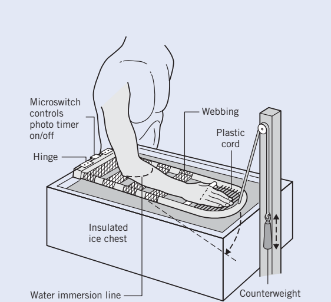
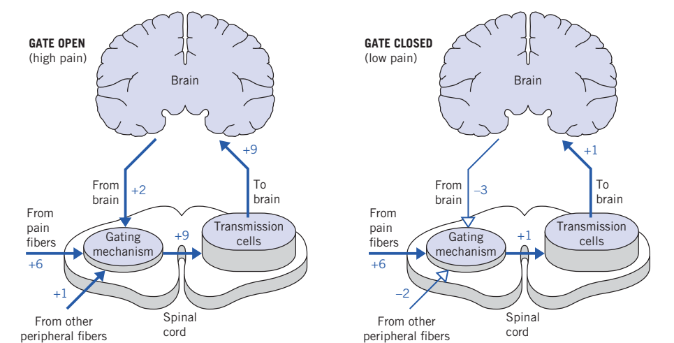
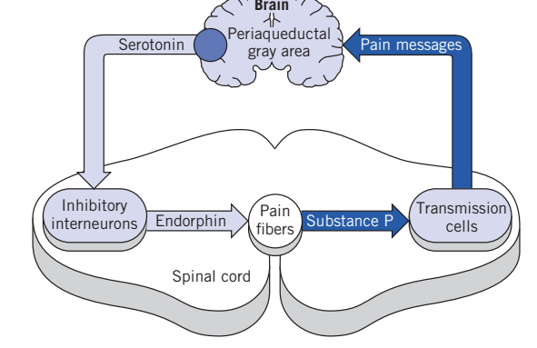
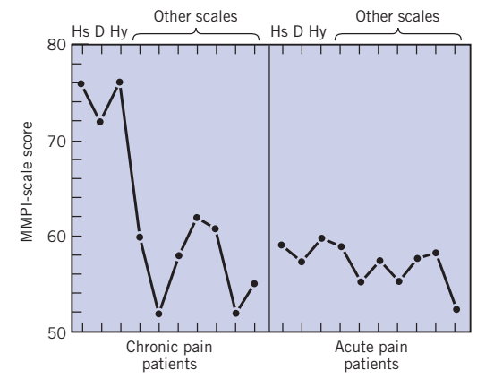
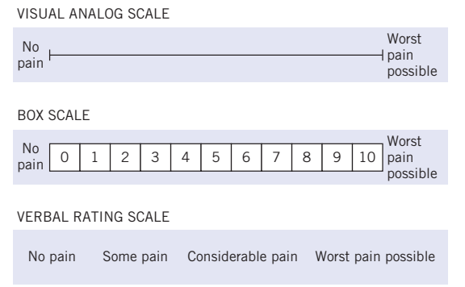
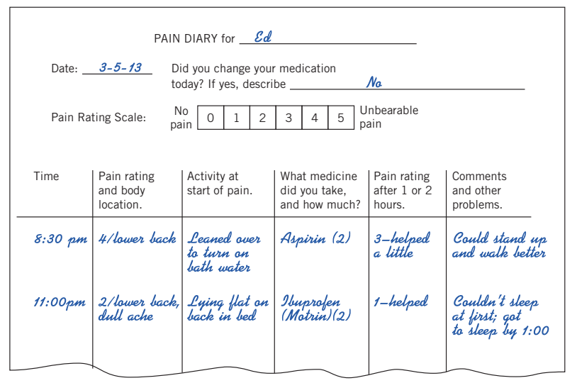
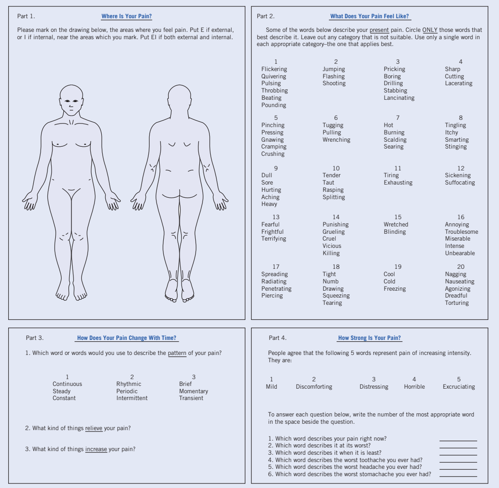

# Chapter 11: The Nature and Symptoms of Pain

返回 [單篇文獻索引](./_index.md) ｜ [知識庫總目錄](../index.md)

## 1. 書目資訊（APA 7th）
- **APA 7th 引用**：Sarafino, E. P., & Smith, T. W. (2017). The nature and symptoms of pain. In *Health psychology: Biopsychosocial interactions* (9th ed., pp. 288–313). Wiley.
- **DOI**：原文未報告（教科書章節）
- **原始檔案**：`raw/papers/Sarafino_HealthPsych_Ch11_The_Nature_and_Symptoms_of_Pain_pp288-313.pdf`

## 2. 研究問題與假設
本章為健康心理學領域綜論章節，圍繞五個核心問題展開（p. 289）：
1. 什麼是疼痛（pain）？疼痛具備哪些質性特徵、時間維度與生理基礎？
2. 在缺乏可偵測器質性病因的情況下，個體為何仍會感受到真實疼痛？
3. 生理神經傳導與心理社會因素（學習、情緒、認知、社會互動）如何共同形塑疼痛經驗？
4. 既然疼痛屬高度主觀經驗，研究者與臨床人員如何客觀且多維度地評估疼痛？
5. 嬰幼兒與兒童的疼痛感知發展與評估方式與成人有何差異？

## 3. 研究對象與方法
- **文獻性質**：整合實證研究、經典實驗、流行病學調查與臨床工具之教科書綜論章節（涵蓋至 2015 年文獻）。
- **涵蓋族群**：一般成人、急慢性疼痛患者（下背痛、偏頭痛、緊張型頭痛、關節炎、癌症、燒傷、牙科患者、截肢幻肢痛患者），以及新生兒與兒童青少年。
- **核心實驗與評估方法**：
  - 實驗室誘痛典範：[冷壓測驗與肌肉缺血程序](../methods/cold-pressor-and-muscle-ischemia.md)（pp. 295–296）。
  - 自陳評估工具：[疼痛評分量表與疼痛日誌](../methods/pain-rating-scales-and-diaries.md)（pp. 306–307）、[McGill 疼痛問卷（MPQ）](../methods/mcgill-pain-questionnaire.md)（pp. 307–309）與 Multidimensional Pain Inventory（p. 309）。
  - 人格與適應評估：[MMPI 神經質三合症（Neurotic Triad）](../methods/mmpi-neurotic-triad.md)（pp. 304–305）。
  - 行為與心理生理評估：UAB Pain Behavior Scale、結構化臨床觀察、家屬觀察紀錄（p. 309）；肌電圖（EMG）、自主神經指標（心率、膚電）與腦電圖誘發電位（EEG evoked potentials）（p. 310）。

## 4. 關鍵統計數據整理（Markdown 表格）

| 主題／經典研究 | 族群或實驗情境 | 關鍵統計數據與實證結果 | 來源與頁碼 |
| :--- | :--- | :--- | :--- |
| 就醫主訴占比 | 臨床門診就醫民眾 | 疼痛占所有醫師就診主訴 **> 80%** | Gatchel et al. (2007), p. 289 |
| 美國成人疼痛盛行率 | 美國 ≥ 18 歲成人（3 個月內） | 關節痛約 **27%**；下背痛約 **28%** | NCHS (2014), p. 289 |
| 燒傷急性痛醫療規模 | 美國燒傷患者（每年） | 超過 **480,000** 起燒傷接受醫療處置 | ABA (2015), p. 292 |
| 疼痛意義效應（Beecher 經典研究） | 二戰重傷士兵 vs. 術後平民男性 | 士兵僅 **49%** 報中重度痛、**32%** 要求麻醉止痛藥；平民卻有 **75%** 報中重度痛、**83%** 要求用藥 | Beecher (1956), p. 294 |
| 實驗室痛閾調節 | 肌肉缺血測驗成人受試者 | 聽喜劇錄音或練習放鬆者之痛閾（壓脈帶壓力）較控制組高 **50%** | Cogan et al. (1987), p. 296 |
| 安慰劑止痛效果 | 各類疼痛患者；膝關節炎手術患者 | 顯著緩解人數約為真實藥物（aspirin/morphine）之**一半**；假手術與真手術組皆有近 **40%** 自評減痛與活動改善 | Melzack & Wall (1982); Rehm & Nayak (2004); Moseley et al. (2002), p. 301 |
| 牙科焦慮與疼痛記憶扭曲 | 牙科門診患者（術前、術後、3 個月追蹤） | 高牙科焦慮者預期與 3 個月後回憶疼痛達實際痛感 **4 倍**；低焦慮者則 **< 2 倍** | Kent (1985), p. 303 |
| 壓力誘發頭痛實驗 | 慢性頭痛 vs. 偶發頭痛成人（1 小時算術壓力） | **> 2/3** 慢性頭痛者與 **1/4** 偶發頭痛者於壓力作業期間誘發頭痛 | Gannon et al. (1987), p. 303 |
| MMPI 神經質三合症切點 | 慢性痛 vs. 急性痛患者 | T 分數 **≥ 70** 僅見於 **< 5%** 一般人口；慢性痛患者於 Hs、D、Hy 平均達 ≥ 70，其餘 7 量表落於常模範圍；急性痛整體接近常模 | Anastasi (1982), p. 304; Cox et al. (1978); Rosen et al. (1987), p. 305 |
| 兒童慢性／復發痛盛行率 | 跨國兒童與青少年 | 頭痛、腹痛、背痛與肌肉骨骼痛平均盛行率 **11%–38%**（女多於男、隨年齡增加） | King et al. (2011), p. 310 |
| 兒童疼痛詞彙發展 | 兒童至青少年 | 幼兒多僅用 hurt/ouch/ow；至 **13 歲**約使用 **26 個**詞彙描述疼痛 | Jeans (1983), p. 311 |

## 5. 關鍵統計圖表摘錄

### 圖 11-1：冷壓測驗裝置（Cold-Pressor Procedure Apparatus）

- **圖說與出處**：維持 2°C（35.6°F）循環冰水以標準化誘發持續性痠痛／壓榨痛之實驗裝置（原文 p. 296，引自 Turk, Meichenbaum, & Genest, 1983）。

### 圖 11-2：門控理論（Gate-Control Theory）開閘與關閘機制

- **圖說與出處**：呈現脊髓背角膠質層（substantia gelatinosa）如何整合疼痛纖維（A-delta、C）、非疼痛周邊纖維（A-beta）與大腦下行訊號，決定傳遞細胞（transmission cells）輸出強度（原文 p. 297，依據 Melzack & Wall, 1965, 1982）。

### 圖 11-3：刺激誘發止痛（SPA）神經化學路徑

- **圖說與出處**：刺激中腦導水管周圍灰質（PAG）後，經血清素活化脊髓抑制性中間神經元、釋放腦內啡（endorphin）抑制疼痛纖維釋放 P 物質（substance P），進而減少上傳至腦部的疼痛訊號（原文 p. 299）。

### 圖 11-4：慢性疼痛與急性疼痛患者之 MMPI 剖面比較

- **圖說與出處**：慢性痛患者於神經質三合症（Hs 慮病、D 憂鬱、Hy 歇斯底里）平均高於臨床顯著線（70 分），其餘七項量表皆於正常範圍；急性痛患者各項均落於常模範圍（原文 p. 305，平均自 Cox, Chapman, & Black, 1978; Rosen et al., 1987）。

### 圖 11-5：三類疼痛強度自陳量表（VAS、Box Scale、VRS）

- **圖說與出處**：臨床與研究最常用之三種單維疼痛強度量表範例（原文 p. 306）。

### 圖 11-6：慢性疼痛日誌（Pain Diary）範例

- **圖說與出處**：追蹤疼痛發作時間、部位與強度、誘發活動、用藥劑量、服藥後評分及伴隨睡眠／情緒困擾之每日紀錄表（原文 p. 307）。

### 圖 11-7：McGill 疼痛問卷（McGill Pain Questionnaire, MPQ）

- **圖說與出處**：涵蓋身體部位標記（Part 1）、20 個詞彙次分類（Part 2，計算 Pain Rating Index）、時間型態（Part 3）與目前疼痛強度（Part 4，Present Pain Intensity）之多維度問卷（原文 p. 308，引自 Melzack, 1975）。

## 6. 核心發現（原文陳述）
1. **疼痛之適應價值與連續體觀點**：先天性無痛症（congenital insensitivity to pain）患者常因無法察覺傷害或急症而早逝，凸顯疼痛的生存保護功能（pp. 288–289）。器質性與心因性疼痛並非截然二分，幾乎所有疼痛皆為生理與心理社會因素交織的連續體（pp. 289–290）。
2. **急性痛與三類慢性痛**：急性痛（< 3 個月）隨復原而焦慮緩解；慢性痛則分為慢性復發型（chronic-recurrent）、慢性難治良性型（chronic-intractable-benign）與慢性漸進型（chronic-progressive），易引發無助、憂鬱與生活功能萎縮（pp. 290–291）。
3. **疼痛與睡眠的雙向惡性循環**：白天高強度疼痛預測當晚睡眠品質差，而差睡眠又預測隔日疼痛加劇；長期睡眠剝奪會升高負向情緒、痛覺敏感度與未來數週的疼痛量（p. 291）。
4. **雙重神經纖維與特殊痛覺現象**：有髓鞘的 A-delta 纖維快速傳遞銳利、定位明確之痛覺至感覺運動皮質；無髓鞘 C 纖維緩慢傳遞鈍痛／灼痛至腦幹與前腦，強烈牽動情緒與動機（pp. 291, 293）。轉移痛、神經病變痛（neuralgia、causalgia、phantom limb pain）與疼痛意義效應顯示痛覺並非單純的組織損傷對應（pp. 293–294）。
5. **門控理論與內生性鴉片系統**：Melzack & Wall 的[門控理論](../concepts/gate-control-theory.md)與後續神經矩陣（neuromatrix）首度以神經生理機制解釋心理因素如何調節疼痛（pp. 297–298）。PAG 刺激誘發止痛（SPA）與[安慰劑效應](../concepts/endogenous-opioids-and-placebo.md)皆涉及內生性鴉片類物質（endorphin、enkephalin），並可被 naloxone 部分或完全阻斷（pp. 299–301）。
6. **制約學習、社會強化與因應**：古典制約可使前驅症狀或疼痛詞彙誘發痛覺相關生理與腦部活化；操作制約與次級獲益（如配偶過度關切、殘障給付）會固化四類[疼痛行為](../concepts/pain-behaviors-and-social-reinforcement.md)（pp. 300–302）。[災難化思考](../concepts/pain-catastrophizing-and-acceptance.md)推動急性痛轉為慢性痛，而[疼痛接納](../concepts/pain-catastrophizing-and-acceptance.md)則促進較佳功能與較低用藥（p. 305）。
7. **多方法疼痛評估與兒童發展**：建議併用至少兩種評估技術（自陳、行為、心理生理）以提升準確度（p. 305）。胎兒在出生前最後數週即能感受疼痛，兒童評估需依年齡與語言能力調整（pp. 310–312）。

## 7. 研究限制與批判評析
- **原文自述之領域限制**：
  - 內生性鴉片系統機制仍未完全明朗（例如 naloxone 並非總能阻斷 SPA、短暫痛與長期慢性癌痛對嗎啡耐受性差異的成因不明，p. 299）。
  - 族群疼痛差異研究結果並不一致，且群體差異對臨床個別化治療幫助有限（Korol & Craig, 2001, p. 302）。
  - MPQ 需較高英文詞彙能力，對語言能力受限者與 12 歲以下兒童適用性有限（p. 309）；自主神經指標易受一般壓力干擾、專一性不足（p. 310）。
  - 兒童人格與家庭特徵如何影響疼痛強度與頻率，實證仍相當有限（p. 312）。
- **跨篇推論與知識庫整合視角**：
  - 本章屬於教科書二級綜論（review），內含大量經典奠基文獻（如 Beecher, 1956；Melzack & Wall, 1965；Melzack, 1975；O'Brien et al., 2011），適合做為本知識庫的基礎架構頁，但後續若用於學術論文寫作或深入口報，應視需要補齊關鍵原始期刊論文。
  - 章節第 291 頁點出的「疼痛—睡眠雙向循環」與「憂鬱、侵入性思考、擔憂（worry）對睡眠的干擾」（Nicassio et al., 2012; Smith et al., 2000），可作為日後串聯失眠認知行為治療（CBT-I）與疼痛共病文獻的核心橋接節點。

## 8. 關聯概念與方法頁面
- 構念與理論：[門控理論與神經矩陣](../concepts/gate-control-theory.md)、[內生性鴉片系統與安慰劑止痛](../concepts/endogenous-opioids-and-placebo.md)、[疼痛行為與社會強化](../concepts/pain-behaviors-and-social-reinforcement.md)、[疼痛災難化與疼痛接納](../concepts/pain-catastrophizing-and-acceptance.md)、[疼痛與睡眠的雙向關聯](../concepts/pain-and-sleep-bidirectional-link.md)
- 方法與量表：[McGill 疼痛問卷（MPQ）](../methods/mcgill-pain-questionnaire.md)、[疼痛評分量表與疼痛日誌](../methods/pain-rating-scales-and-diaries.md)、[冷壓測驗與肌肉缺血程序](../methods/cold-pressor-and-muscle-ischemia.md)、[MMPI 神經質三合症](../methods/mmpi-neurotic-triad.md)
