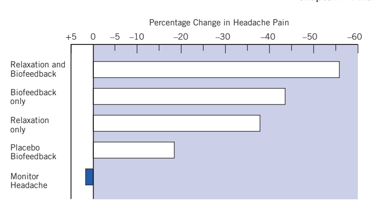
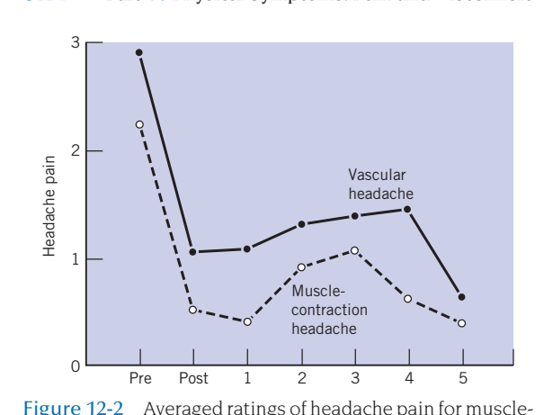
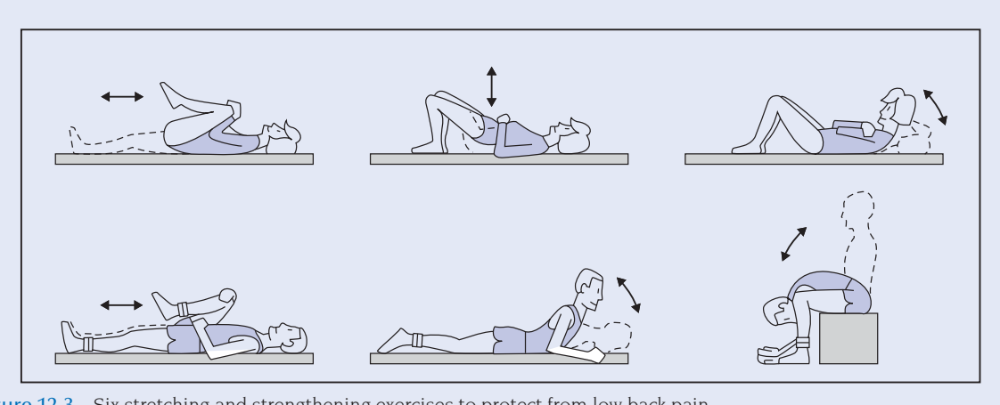

# Chapter 12: Managing and Controlling Clinical Pain

返回 [單篇文獻索引](./_index.md) ｜ [知識庫總目錄](../index.md)

# Managing and Controlling Clinical Pain

## 1. 核心研究架構與臨床疼痛定義
臨床疼痛（clinical pain）指接受或需要專業照護之任何疼痛，涵蓋急性與慢性狀態。控制臨床疼痛不僅具人道關懷價值，亦能預防因高疼痛與壓力引發之免疫與內分泌功能受損、傷口癒合延遲及轉向慢性化。急性疼痛若伴隨多重創傷性生活事件、高憂鬱傾向及「病況將永久化」之早期信念，極易演變為慢性疼痛。慢性疼痛往往導致自我效能喪失、活動恐懼、肌肉萎縮、憂鬱以及 [MMPI 神經質三合症](../methods/mmpi-neurotic-triad.md)（慮病、憂鬱、歇斯底里）。

### 表 12.1：美國成年人持續超過 24 小時之疼痛盛行率統計（依年齡、持續時間與部位分佈）

| 年齡區間（歲） | < 1 個月 (%) | 1 至 3 個月 (%) | 3 至 12 個月 (%) | > 1 年 (%) | 下背痛 (%) | 嚴重頭痛 (%) | 頸部疼痛 (%) | 關節疼痛 (%) |
| :--- | :---: | :---: | :---: | :---: | :---: | :---: | :---: | :---: |
| 18/20 至 44 | 39.1 | 11.9 | 12.5 | 36.5 | 23.9 | 18.4 | 12.4 | 20.5 |
| 45 至 64 | 27.2 | 13.6 | 15.5 | 43.7 | 30.8 | 15.0 | 18.7 | 39.9 |
| 65 歲以上 | 18.9 | 10.4 | 13.4 | 57.3 | 30.4 | 6.2 | 14.4 | 49.9 |

> *註*：資料來源自 NCHS (2006)。關節疼痛有 27% 受訪者評定強度達嚴重等級（VAS 75–100 mm 區間）。

## 2. 醫學治療方法（Medical Treatments）
1. **外科手術（Surgical Methods）**：包括神經切斷術（neuroablation，阻斷周邊神經或脊髓訊號傳導）、脊椎融合術（spinal fusion）與椎板切除術（laminectomy）。研究顯示長期減痛效果未優於物理治療等非侵入式療法，且對合併心理障礙者效果不佳。
2. **化學藥物治療（Chemical Methods）**：
   - **周邊活性鎮痛劑（Peripherally active analgesics）**：如乙醯胺酚（acetaminophen）與非類固醇消炎止痛藥（NSAIDs），抑制致痛化學物質合成並緩解發炎。
   - **中樞活性鎮痛劑（Centrally acting analgesics）**：鴉片類藥物（narcotics/opioids），結合中樞神經系統鴉片受體阻斷痛覺傳導。在急性痛（如病患自控止痛法 PCA）成癮風險極低；在慢性非癌疼痛長期使用平均減痛約 1/3，但伴隨耐受性與心血管等副作用風險。
   - **局部麻醉劑（Local anesthetics）**：如 novocaine、lidocaine，阻斷神經動作電位產生。
   - **間接作用藥物（Indirectly acting drugs）**：抗憂鬱劑，約能顯著減輕 1/3 慢性疼痛患者之痛楚。

## 3. 行為與認知介入方法（Behavioral and Cognitive Methods）
- **[操作制約疼痛管理](../concepts/operant-pain-management.md)**：透過消弱程序（extinction，忽視外顯呻吟抱怨）並以代幣或讚許系統性強化健康行為（well behavior）。給藥採定時定量之「疼痛調酒（pain cocktail）」策略，打破「抱怨即獲給藥」之隨伴強化關係。
- **恐懼減輕與體內暴露（In Vivo Exposure）**：針對下背痛患者因畏懼疼痛而形成的活動迴避（fear-avoidance），依恐懼活動階層表逐步進行暴露，破除逃避所帶來的負向強化循環。
- **放鬆訓練與肌電圖生理回饋（EMG Biofeedback）**：針對緊縮型頭痛與偏頭痛，放鬆訓練與生理回饋平均可降低 40% 至 50% 頭痛頻率，療效約為安慰劑組的兩倍。
- **[認知應對與疼痛重構](../concepts/cognitive-coping-and-redefinition.md)**：包含分心（distraction，適合輕中度急性痛）、引導意象（guided imagery）與疼痛重構（pain redefinition，運用應對句與再詮釋句對抗災難化信念，適合強烈慢性疼痛）。此外，結合接納與承諾治療（ACT）促進即使處於疼痛狀態仍維持目標承諾與生活功能。

## 4. 刺激與物理療法（Stimulation and Physical Therapies）
- **對抗刺激（Counterirritation）**：依據 [門控理論與神經矩陣](../concepts/gate-control-theory.md)，周邊粗纖維之刺激訊號可關閉脊髓背角閘門。[經皮神經電刺激](../methods/transcutaneous-electrical-nerve-stimulation.md)（TENS）與高強度刺激具急性止痛效果，脊髓電刺激（spinal cord stimulation）則對頑固性慢性疼痛有效。
- **針灸（Acupuncture）**：臨床試驗顯示其止痛效果主要受刺激強度而非穴位位置影響，且易催眠者反應較佳，長期慢性痛療效與假針灸（sham acupuncture）相當。
- **物理治療（Physical Therapy）**：漸進式伸展與肌力訓練對於慢性下背痛與關節炎具有顯著功能改善效益。

## 5. 多科整合疼痛診所（Multidisciplinary Pain Clinics）
多科整合疼痛診所結合醫學、臨床健康心理學、物理治療、職能治療與職業重建，全方位介入。整合性方案在 4 週密集住院治療後，高達 90% 病患成功戒除止痛藥物，且 1 至 5 年追蹤顯示工作復職率達對照組之 3 倍（約 2/3 vs. 1/5），平均自評疼痛指數顯著持續下降（由 4.6 降至 1 年後的 1.2）。

## 自動擷取之關鍵圖表

### 圖 12.1：跨研究統計慢性緊縮型頭痛患者在各項介入（肌電生理回饋合併放鬆、純生理回饋、純放鬆、安慰劑回饋與純監測）治療前後之頭痛改善百分比（第 323 頁）

### 圖 12.2：緊縮型頭痛與血管型頭痛患者接受放鬆與生理回饋訓練後，由治療前至 5 年追蹤期間之疼痛評級長期維持趨勢（第 324 頁）

### 圖 12.3：預防與舒緩下背痛之六項核心伸展與肌力強化運動示範圖（第 333 頁）

